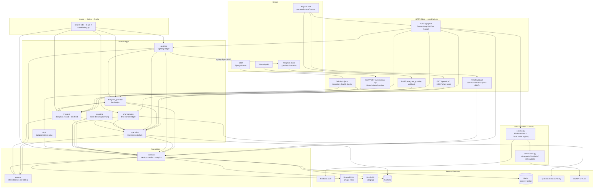

# System Component Registry & Architecture Map

> Source of truth for the app list is `INSTALLED_APPS` in [rosak/settings.py](../rosak/settings.py). Per-app detail: [docs/components/](components/). Narrative, root cause and fix for every trap below: [MISTAKES.md](../MISTAKES.md).
>
> **Scope note:** nine `INSTALLED_APPS` entries are first-party apps with a component doc: `operation`, `common`, `reporting`, `generic`, `spotting`, `incident`, `mlptf`, `chartography`, `telegram_provider`. A tenth, `jejak` (optional GPS-trace app: provider models, admin, `jejak/schema/`), is appended only when all `TIMESCALE_*` env vars are set (`JEJAK_ENABLED`); it adds the `timescale` database, `rosak.routers.timescale.TimescaleRouter` (appended to `DATABASE_ROUTERS`) and `JejakScalars`/`JejakMutations` in the root schema, and has no component doc. The remaining entries (`django.contrib.*`, `hijack`, `strawberry_django`, `health_check.*`, `safedelete`, `simple_history`, `cachalot`, `tree_queries`, `django_celery_*`, `django_cleanup`, `colorfield`, `advanced_filters`, `rangefilter`, `mdeditor`, `ordered_model`, `corsheaders`, `django_extensions`, plus `debug_toolbar` when `DEBUG`) are third-party packages, catalogued as the **Infrastructure Layer** below. The `rosak` project package is not an app but _is_ a component (schema assembly, request context, permissions, beat schedule), so it is catalogued too.

---

## 🗺️ High-Level System Topology



**The flow in one paragraph.** Every read/write from the SPA lands on a single async GraphQL endpoint. `rosak/context.py` resolves the Firebase bearer token into a `common.User` (lazily `get_or_create`d — there is no signup flow) and attaches a per-request, `deepcopy`'d registry of DataLoaders contributed by four apps (`common`, `incident`, `operation`, `spotting`). The schema is assembled by multiple inheritance in [rosak/schema.py](../rosak/schema.py) — six apps (seven with `jejak`) mix `*Scalars` into `Query` and `*Mutations` into `Mutation`, so there is no routing layer. `operation` is the reference-data hub every other domain app foreign-keys into; `common` is the substrate underneath all of them (identity, media, date-bucketing analytics); `generic` is a table-less shared kernel of GIS and enum primitives. Writes arrive by five paths — GraphQL mutations, the DRF `/upload/` endpoint, the Telegram webhook, the X webhook, and Django admin — and the interesting ones are asynchronous: images enter a staged state machine (`TemporaryMedia` → Discord CDN → `Media`) driven by a `post_save` signal, and time-series fleet counts are written only by Celery tasks.

### Cross-cutting facts worth holding in context

**Ingress surface** — GraphQL `POST /graphql/` (introspection disabled when `DEBUG=False`); `POST /upload/` (multipart, authenticated by the `Firebase-Auth-Key` header rather than GraphQL context); three DRF chart feeds under `/operation/` (one returns CSV built with `polars`); `POST /telegram_provider/` (self-registering webhook, polling disabled); `GET/POST /webhooks/x-api` (X Activity API receiver — GET answers the CRC registration challenge, POST ingests a signed `post.create` delivery into `SocialMediaLink`; `csrf_exempt` because it authenticates by HMAC over the raw body, must ack within 10 s, and Telegram-notifies off a Celery task; registered in `rosak/urls.py` inside an `apps.is_installed("incident")` block); `/admin/`, `/hijack/`, `/advanced_filters/`, `/mdeditor/`, `/health-check/`; a Sentry tunnel at `/sentry/` and `/version/`. In production, every unmatched path is caught by `custom_view.redirect_view` — a rickroll.

**Celery beat — 9 entries, all declared centrally in [rosak/celery.py](../rosak/celery.py), none locally: 8 unconditional plus the official-post poll, which is **opt-in** (`OFFICIAL_POST_POLLING_ENABLED`, default off).** Crontab times are local `TIME_ZONE` (Asia/Kuala_Lumpur): `CELERY_TIMEZONE` is set only `if USE_TZ` (and `USE_TZ = False`), but Celery's `Settings.timezone` falls back to Django's `TIME_ZONE` (`app.timezone` checked in the `app` container). 03:00 is also the spotting _service-day cutoff_ (`telegram_provider.utils.DEFAULT_SPOTTING_CUTOFF`, used by `/spotting_today` and `report_spotting_today`); it is unrelated to the beat times.

| Schedule     | Task                                                                          | Owner               |
| ------------ | ----------------------------------------------------------------------------- | ------------------- |
| every 1 min  | `cleanup_temporary_media_task` — re-drive stalled uploads, purge `TO_DELETE`  | `common`            |
| every 5 min  | `ingest_official_posts` — pull tracked X accounts into `SocialMediaLink` + Telegram the admin per new post. **Opt-in**: not scheduled unless `OFFICIAL_POST_POLLING_ENABLED=true` (webhooks are the primary path). The schedule is built at import, so toggling needs a `celerybeat` restart; the task also no-ops unless the master flag + token are set, and skips the notification when `TELEGRAM_ADMIN_CHAT_ID` is blank | `incident` |
| every 10 min | `cleanup_expired_verification_codes`                                          | `common`            |
| 00:00        | `report_spotting_today` — per-channel Telegram digest via `send_message`, for the service day that just ended (`effective_spotting_date`) | `spotting`  |
| 01:00        | `aggregate_line_vehicle_status_mtrec_task` — external scrape                  | `chartography`      |
| 03:00        | `cleanup_telegram_logs` — 30-day retention                                    | `telegram_provider` |
| 03:00        | `purge_soft_deleted_incidents` — hard-delete soft-deleted incidents past 90 days | `incident`       |
| 03:30        | `purge_rejected_incidents` — hard-delete `REJECTED` incidents unchanged for 30 days | `incident`    |
| 05:00        | `aggregate_line_vehicle_status_mlptf_task` — internal aggregation             | `chartography`      |

**Two tasks run off-beat.** `incident.tasks.notify_official_post_links` is dispatched by the `/webhooks/x-api` view, not by a schedule — X requires a 200 within 10 seconds, so the view commits the rows and enqueues this task rather than sending Telegram inline. It reuses the polling task's `_notify_created_links`, so both paths format the message and write the `TelegramSocialMediaLinkLog` join row (the thing that makes `/approve` by reply work) identically.

`incident.tasks.notify_push_subscribers(incident_id)` is enqueued by `approve_incident` (`transaction.on_commit`, `robust=True`) whenever an approval makes an incident newly LIVE, or a merge escalates a LIVE incident to MAJOR. It web-pushes LIVE MAJOR incidents through FCM (`firebase_admin.messaging`) to the `PushSubscription` tokens of the affected lines, at most once per line per 30 minutes. The cooldown is an atomic `cache.add` key, so local `DEBUG=True` (`DummyCache`) never limits it. Retries are bounded: `autoretry_for=FirebaseError`, `max_retries=3`, backoff capped at 600 s. `send_each_for_multicast` returns an FCM outage per token instead of raising it, so the service raises `UnavailableError` itself when a chunk delivers nothing and sees a transient error. Detail: [incident.md](components/incident.md) (Web push).

**Dependency graph shape.** The app graph is heavily cyclic. `generic` and `mlptf` import no first-party code (`mlptf` reaches `common.User` by string FK, and `common/admin.py` imports `mlptf`); `reporting` is the sole pure _consumer_ (nothing imports it but `rosak/schema.py`). Cycles: `common`↔`spotting`, `common`↔`incident`, `common`↔`operation`, `operation`↔`incident`, `operation`↔`spotting`, `operation`↔`chartography`, `spotting`↔`telegram_provider`, `incident`↔`telegram_provider`, and `common`↔`mlptf` at model level. Most are tolerated via lazy string model references or function-local imports; the one genuine hazard is `common/tasks.py`, which imports `spotting` and `incident` at module top level. No import-boundary tool (`tach`) is configured; this is the record. Break new cycles with lazy string refs or function-local imports. Current first-party import edges (`X → Y`: X imports Y at module level or inside a function; tests and migrations excluded; `chartography`, `common`, `incident`, `spotting` and `telegram_provider` also import `rosak` for the Celery app, permissions or context):

```
chartography      → common, operation
common            → generic, incident, mlptf, operation, spotting
incident          → common, generic, operation, telegram_provider
operation         → chartography, common, generic, incident, spotting
reporting         → operation            (schema/scalars.py only; model refs are strings)
spotting          → common, generic, operation, telegram_provider
telegram_provider → common, generic, incident, operation, spotting
rosak             → chartography, common, incident, operation, reporting, spotting, jejak (if JEJAK_ENABLED)
generic, mlptf, jejak → (none)
```

**GraphQL root membership is narrower than `INSTALLED_APPS` suggests.** Six apps (plus `jejak` when enabled) are mixed into the root types, but `reporting`'s contributions are entirely commented out and `ChartographyScalars` is an empty type. Effective root **query** providers: `operation`, `common`, `spotting`, `incident` (+ `jejak`). Effective **mutation** providers: `common`, `spotting`, `incident`, `chartography` (one admin-gated trigger) (+ `jejak`). `operation` and `reporting` expose _no mutations_ (their write paths are Django admin and Celery; `OperationMutations` is empty with its write API commented out). `generic`, `mlptf` and `telegram_provider` have no GraphQL surface at all.

---

## 📚 Component Catalog

| Component Name | Layer/Location | Core Responsibility | Key Dependencies | Primary Extension Point |
| --- | --- | --- | --- | --- |
| [**operation**](components/operation.md) | Django domain + PostGIS persistence; GraphQL read API + 3 DRF feeds — [operation/](../operation/) | Canonical reference data for the physical network: `Line`, `Station`, `StationLine`, `Vehicle`, `VehicleType`, `VehicleLine`, `Asset` (lifts/escalators). The spine every other domain app FKs into. **Read-only over GraphQL.** | `common` (Media, `get_trends`), `incident`, `spotting`, `chartography`, `generic`; `simple_history`, `polars`, `django.contrib.gis` | Thirteen DataLoaders in `OperationContextLoaders` (add one dict key); pre-written-but-commented `inputs.py` + empty `OperationMutations` are a designed slot for the first write API |
| [**common**](components/common.md) | Django foundation: persistence + infra adapters + GraphQL slice + DRF upload view + 5 Celery tasks — [common/](../common/) | The substrate: Firebase-backed `User` identity, `Clearance`/`FeatureFlag` authorization primitives, the entire media ingestion pipeline (`TemporaryMedia` → `Media`), the universal `Vote` model, and `get_trends()` — the shared date-bucketing analytics engine | `firebase-admin`, `discord-webhook`, `boto3`/`django-storages`, Pillow+`pillow_heif`, `imgurpython` (deprecating); imports `spotting`/`incident`/`operation`/`mlptf`/`generic` | `FeatureFlag` + `should_upload_media()` runtime kill switch; `TemporaryMediaType` + `TemporaryMedia.metadata` to extend the upload pipeline to new destination models; `ClearanceType` for new capabilities |
| [**spotting**](components/spotting.md) | Django domain + PostGIS; GraphQL read/write + 1 Celery task — [spotting/](../spotting/) | The community sighting ledger: a user asserts an `operation.Vehicle` was seen on a date, in a state, at a station pair / depot / GPS point. Everything downstream (fleet charts, "last spotted", digests) derives from it | `common` (User, Media, `GenericMutationReturn`), `operation` (Vehicle, Station), `generic.WebLocationModel`, `telegram_provider.utils`, `python-telegram-bot`, PostGIS | `@strawberry_django.filter_field` on `EventFilter` (context-aware filters); `EventSource` + `SpottingDataSource` + its JSON `data` column — the designed seam for new ingestion channels; `SpottingConfig.ready()` for signals |
| [**incident**](components/incident.md) | Django domain + PostGIS; GraphQL read/write + 1 inbound HTTP view (X webhook) + 5 Celery tasks — [incident/](../incident/) | The disruption record, in two structurally disconnected tiers: a per-asset ledger (`VehicleIncident`, `StationIncident`, `is_last` marking current state) and network-level `CalendarIncident` + `CalendarIncidentChronology` spans with markdown detail and `impact_factor`. Also the social-link feed (threaded `SocialMediaLink` tree, votes), `LineStatusReport`s, and the official-post ingestion pipeline — polling (opt-in) and the `/webhooks/x-api` receiver. Also web push: `PushSubscription` (FCM token per browser, lines followed) and MAJOR-incident alerts on approval | `operation` (Vehicle/Station FKs, Line/Station/Vehicle M2Ms, filters, scalars), `common.Media`/`Vote`, `generic.GeometricForm`, `ordered_model`, `django-safedelete`, `django-tree-queries`, `simple_history`, `mdeditor`, `pendulum`, `requests`, `firebase-admin` (FCM messaging), `telegram_provider.models`/`utils` | The abstract triad `IncidentAbstractModel`/`Scalar`/`Filter` — a new incident target is 4 subclasses and no edits; `IncidentMutations` composes six mixins (`IncidentCrudMutations`, `ChronologyMutations`, `VoteMutations`, `SocialMediaLinkMutations`, `ExtractionMutations`, `PushMutations`), so a new write path is a new mixin; `CalendarIncidentCategory` is data-not-migrations; `IngestPlatform` is the seam for a second source platform |
| [**chartography**](components/chartography.md) | Django batch-ingest + GraphQL mutation; Celery write path — [chartography/](../chartography/) | _Chart_-ography, **not** cartography — zero geo fields. An append-only daily time-series ledger of vehicle-status counts per line, ingested from multiple third-party fleet trackers, providing the history the live `operation` models cannot | `operation.Line`/`VehicleLine`/`VehicleStatus`, `common.User`, `common.GenericMutationReturn`, `requests`, `rosak.permissions` | New source = new `DataSources` member + task + beat entry, no model change (`PRASARANA`/`MRFC` are declared-unimplemented slots); `SourceCustomLine` mapping reconciles upstream taxonomies at runtime; empty `ChartographyScalars` awaits root queries |
| [**telegram_provider**](components/telegram_provider.md) | Django integration/adapter: ASGI-async views + PTB `Application` + 1 Celery task — [telegram_provider/](../telegram_provider/) | The Telegram bridge and the only conversational surface: webhook ingest, raw-payload audit log, 13-entry `handlers_dict` dispatch (spotting, social-link submit/delete, `/approve`), argparse-based text→`spotting.Event` conversion, identity linking, and the governed egress path `utils.send_message` (audit row, bounded retry, dead-letter) | `python-telegram-bot`, `django_asgi_lifespan`, `httpx`, DRF; writes `spotting.Event`, updates `common.User.telegram_id`, reads `operation.Line`/`Vehicle`, calls `incident.services` | `handlers_dict` in `apps.py` — one dict entry auto-drives registration, `/help` text and Telegram menu sync; `spotting_parser()` for new grammar; `add_handlers` accepts `MessageHandler`/`CallbackQueryHandler` with no schema change |
| [**generic**](components/generic.md) | Table-less shared kernel spanning ORM + admin + GraphQL primitives — [generic/](../generic/) | One definition of the cross-cutting primitives: `WebLocationModel` (abstract GIS), `GeometricForm` (lat/long admin widget, in `generic/views.py`), `JsonPrettifyAdminMixin`, `DateGroupings` enum, `WebLocationInput`, and five GeoDjango↔GraphQL scalars. **Contributes zero migrations.** | `django.contrib.gis`, `strawberry`, `pygments`. Imports no first-party app | Abstract-model and admin-form inheritance (5 apps already do it); `generic/schema/scalars.py` as the home for new geo scalars — `GeoLineString`/`GeoPolygon`/`GeoLinearRing`/`GeoMultiPoint` are defined and wired to nothing |
| [**reporting**](components/reporting.md) | Django domain + GraphQL scaffolding — [reporting/](../reporting/) | Crowd-sourced defect reports against station assets (escalators/lifts), and the only triage workflow in the repo: `Report` + `reporting.Vote` corroboration + `Resolution` closure. **Dormant** — models/admin live, entire GraphQL surface commented out, one migration since 2022-07 | `operation.Asset`, `common.User`/`Media` (lazy refs), `django-model-utils` (`SoftDeletableModel`, `UUIDModel`) | Uncommenting: the root `Query`/`Mutation` already inherit its stubs, so re-enabling needs no `rosak/schema.py` change; `ReportType` widens additively; through-models `ReportMedia`/`ReportResolution` carry per-link metadata |
| [**mlptf**](components/mlptf.md) | Django persistence + admin only — [mlptf/](../mlptf/) | Community **badges** only — `Badge` + `UserBadge` through-model. Despite the org name it models no membership, chapters or roles (identity lives in `common.User`, authz in `common.Clearance`). No views, urls, schema, tasks or signals | `common.User` (FK + M2M), `django-model-utils`. On `common`'s **migration critical path** via `common/migrations/0002_user_badges.py` | `UserBadgeStackedInline` (already reused by `common.admin.UserAdmin`); `UserBadge` as explicit through-model for `awarded_by`/`reason`/`revoked`. Otherwise thin — a consumer-facing badge feature starts with net-new plumbing |
| **rosak** _(project, not an app)_ | Composition root — [rosak/](../rosak/) | Schema assembly by multiple inheritance, per-request GraphQL context (`FirebaseUser` + DataLoader registry), the three Strawberry permission classes, the central beat schedule, Sentry tunnel, settings | All schema-bearing apps; `strawberry`, `django_asgi_lifespan`, `sentry_sdk`, `dotmap` | `ContextLoaders` dict (one key per app); `permissions.py` for new `BasePermission` classes; `beat_schedule` for new periodic work (`autodiscover_tasks()` means new `tasks.py` files need no registration) |

### Infrastructure Layer (third-party `INSTALLED_APPS`, not analyzed individually)

| Concern | Packages | Notes |
| --- | --- | --- |
| GraphQL | `strawberry_django` 0.82.1 (strawberry-graphql 0.323.2) | Optional inputs are `strawberry.Maybe[T \| None] = strawberry.UNSET` (`jejak` filters default to `None`); `DjangoOptimizerExtension` always on; `NoSchemaIntrospectionCustomRule` added when `DEBUG=False`. Tri-state semantics and conventions: [STRAWBERRY_MIGRATION.md](STRAWBERRY_MIGRATION.md) |
| Caching | `cachalot`, `django.middleware.cache.*` | Redis-backed with `ENVIRONMENT` key prefix; **`DummyCache` when `DEBUG=True`** |
| Async tasks | `django_celery_beat`, `django_celery_results` | Results in `django-db`; a separate `celery` DB cache alias |
| Audit / history | `simple_history` | On `operation.Vehicle`, `operation.Asset`, `incident.CalendarIncident`, `incident.CalendarIncidentChronology`. Only the incident trail is exposed (`calendarIncidentHistory`); operation's is a queryable trail nothing exposes |
| Soft delete | `safedelete` | `incident.CalendarIncident` and `CalendarIncidentChronology` (`SafeDeleteModel`); purged by the incident beat tasks |
| Tree | `tree_queries` | `incident.SocialMediaLink` (`OrderableTreeNode`); `INSTALLED_APPS` raises `tree_queries.E001` if it is omitted. See the tree entries in MISTAKES |
| Admin UX | `hijack`, `advanced_filters`, `rangefilter`, `colorfield`, `ordered_model`, `mdeditor` | Admin is a first-class write path here, not an afterthought |
| Ops | `health_check` (+db/cache/storage/migrations/celery_ping/psutil/redis), `sentry_sdk`, `django_extensions` | `/health-check/` covers broker and disk/memory |
| Files | `django_cleanup` (must stay last), `django-storages`/`boto3` | Default storage is Oracle S3-compatible |

---

## 💡 Potential Feature Opportunities

Non-AI features — ordinary engineering and product work. Each of the nine component docs carries its own `## 💡 Potential Feature Opportunities` section with 5 items, each tagged `Ready` / `Partially ready` / `Not ready` and, where not ready, the exact blocker and the files to touch. This section indexes them, then adds the cross-cutting features that no single component doc could see. (The `🎯` section below covers the AI-flavoured cross-cutting set.)

### Readiness index

**Ready now — no blockers**

| Component | Feature |
| --- | --- |
| [operation](components/operation.md) | Collapse the seven hand-written `vehicle_status_*_count` fields into one generated `statusCounts` |
| [common](components/common.md) | Filterable media gallery with back-links to the entry each photo documents |
| [common](components/common.md) | A real platform-wide feature-flag surface |
| [spotting](components/spotting.md) | Per-user read/unread inbox for sightings |
| [incident](components/incident.md) | Put asset-level incidents on the map, with their photo evidence |
| [chartography](components/chartography.md) | Give `chartography` a first-class GraphQL read surface |
| [chartography](components/chartography.md) | Honour `force` so a bad ingest run can be repaired |
| [telegram_provider](components/telegram_provider.md) | Chat-scoped, indexed spotting provenance |
| [generic](components/generic.md) | A typed, shared point-and-radius search input |
| [generic](components/generic.md) | A `GeometricForm` that is safe to reuse, unblocking further GIS admin screens |

**Partially ready — a named blocker stands in the way**

- **operation** — station accessibility board ("which lifts work here"); fleet/asset change timeline from `HistoricalRecords`; staff-authenticated GraphQL write API
- **common** — finish the Imgur retirement and delete the subsystem; upload receipts + dead-letter queue for failed conversions
- **spotting** — an `editEvent` mutation with the contribution window expressed once; moderation queue for fleet-contradicting sightings; contributor leaderboards, streaks and "sets you have never spotted"
- **incident** — per-line reliability score from `impact_factor`; public status page + subscribable ICS/Atom/RSS disruption feed
- **chartography** — admin-editable source-to-line reconciliation (delete the hardcoded PK map); deterministic side-by-side source comparison
- **telegram_provider** — deterministic station-location capture typed at the constraint level; tap-to-confirm disambiguation
- **generic** — route/service-area geometry for `operation.Line`; validation parity between the GraphQL and admin ingestion paths
- **reporting** — ship the drafted submission/browse surface; one vote per person, withdrawable; "is the lift working right now?" on the station page
- **mlptf** — deterministic rule-based badge awarding as a nightly Celery task; scheduled/seasonal badge reveals using `Badge.released`

**Not ready — good idea, needs schema or plumbing first**

- **operation** — route-ordered station sequences (strip maps, "next stations"): `StationLine` has no ordinal field and `Meta.ordering` sorts lexicographically
- **common** — content-hash de-duplication and duplicate-safe join rows: needs a `content_hash` column plus a re-download backfill
- **spotting** — map view of sightings, GPS on every event type: `LocationEvent` is an FK not a `OneToOne`, and the check constraint never requires coordinates for `type=LOCATION`
- **incident** — "all incidents in this disruption" (one FK to join the two tiers)
- **chartography** — date-ranged backfill and replay tooling: neither task has replayable history, so backfill would fabricate data without a raw-payload archive first
- **telegram_provider** — clearance-gated commands and self-serve channel binding with `/status`
- **generic** — `QUARTER` / `HOUR` members for `DateGroupings`
- **reporting** — explicit report status lifecycle + orderable open-fault feed; photo evidence on a report (no `REPORTING_*` member in `common.TemporaryMediaType`)
- **mlptf** — read-only badge exposure on the user graph; badge rarity and holder listings; badge sprites in the project's own media pipeline

### Cross-cutting features (span components; not visible from any single doc)

**1. A rider-facing station page: accessibility, live faults and incidents in one query** _(operation + reporting + incident)_

Three apps each hold one third of "what is broken at this station right now" and none of them can answer it. `operation.Asset` carries `status` and `asset_type` for lifts and escalators; `reporting.Report` already FKs to `operation.Asset` with community voting and resolution; `incident.StationIncident` holds the editorial record with a real `PointField`. This is the most valuable unbuilt rider feature in the repo and the highest-value reason to un-park `reporting`.
**Readiness:** `Partially ready` — the asset half is built (`Asset.status` and `AssetFilter.status` expose the `AssetStatus` enum, `IN_OPERATION` / `UNDER_MAINTENANCE`); two small, independent blockers remain: `reporting` has no `loaders.py` and no `"reporting"` key in `rosak/context.py`; and `reporting` already imports `operation`, so an `operation → reporting` import would add a cycle (see the import edges above) — the join belongs on the `reporting` side or behind a DataLoader.

**2. Per-user subscriptions instead of one blanket channel dump** _(spotting + common + telegram_provider)_

`report_spotting_today` posts one digest per channel at 00:00 with no per-user concept, yet the per-user machinery already exists: `EventRead`, `EventScalar.is_read`, `EventFilter.is_read` and the `markAsRead` mutation are all user-scoped and `IsLoggedIn`. `common.User.telegram_id` gives the delivery address and `common.Clearance` gives the capability model.
**Readiness:** A preferences model (which lines, which vehicle types, what hour) is `Not ready` — new model plus migration.

**3. Shared geo primitives give three apps "near me" at once** _(generic + operation + spotting + incident)_

`operation.StationFilter.location` is the only proximity filter in the codebase and types its argument as untyped `strawberry.scalars.JSON`, so omitting `radius` reaches `Distance(km=None)`. Meanwhile `spotting.LocationEvent` and `incident.IncidentAbstractModel` both carry `PointField`s and expose **no** geo filtering at all. Promoting `generic/types.py`'s dead `Point2D_SearchField` TypedDicts into a real `@strawberry.input` plus a shared `Q`-builder makes one app's ad-hoc filter a platform capability.
**Readiness:** `Ready` for the point-radius input. The route-geometry extension is `Partially ready` (`GeoMultiPoint` is a distinct `NewType` in `generic/schema/scalars.py`).

---

## 🎯 Cross-Component Feature Opportunities

### 1. Operator announcement → auto-drafted `CalendarIncident` _(telegram_provider + incident + operation)_

The single largest missing edge in the dependency graph: `telegram_provider` ingests operator channel messages and reads no `CalendarIncident` data (its `incident` use is the social-link `/link`, `/deletelink` and `/approve` handlers through `incident.services`, plus the `TelegramSocialMediaLinkLog` join), so every disruption record is still hand-typed in admin or the console. Every piece needed already exists — `TelegramLogs.payload` retains the full raw JSON (30-day window), `operation.Line.telegram_channel_id` gives channel→line routing, `incident.services` and `IncidentCrudMutations` are the write path, `CalendarIncidentChronology.source_url` provides citation, and `inaccurate=True` is a purpose-built "unverified, awaiting review" flag. An extraction step proposing `(start_datetime, end_datetime, severity, lines[], title, brief)` plus successive chronology rows turns a manual editorial task into a review queue. **Highest value, moderate friction** — the only new plumbing is a `MessageHandler` for channel text (`media` already registers one for photos/videos) and a draft-creating call into `incident.services`.

### 2. Upgrade the media moderation gate _(common + spotting + incident)_

`check_temporary_media_nsfw` runs for non-trusted uploaders (trusted bypass: `TRUSTED_MEDIA_UPLOADER` → `TRUSTED_CLEARED`), but it races conversion and cannot reliably gate publishing (see traps). Beyond fixing the ordering, the upgrade is structured multimodal output (category, confidence, reason) in place of a single NSFW probability.

### 3. Wire `impact_factor` into a per-line reliability index _(incident + chartography + operation)_

`CalendarIncident.impact_factor` is wired through column, admin field, GraphQL field, edit services and ordering key, with a `help_text` specifying "scores to deduct from a full score of 100 per day, prorated by usual service hours" — and **no consumer computes anything from it**. Meanwhile `chartography` is a provider-agnostic, append-only `Snapshot` → `*CountHistory` ledger explicitly shaped to take additional metric families, and `operation` already serves per-line daily series over DRF. Joining incident spans to fleet-status history yields the reliability metric the column was specified for, plus assisted `impact_factor` suggestion at admin-save time from span duration, affected-line count and chronology length. **Low friction** — one new metric table following an existing shape, no changes to `incident`.

### 4. Close the contribution loop: badges + digests _(mlptf + spotting + common + telegram_provider)_ — **low-hanging fruit**

`mlptf` is currently a **write-only admin table**: badges are unreachable from GraphQL even transitively through the user graph, and awarding is entirely manual, even though the adjacent apps hold exactly the signals you would award on. Everything for the read side already exists — `common.UserScalar` computes `favourite_vehicles`, `with_most_entries`, `spottings_count` and `spotting_trends`; `UserBadge` is an explicit through-model ready for `awarded_by`/`reason`; `telegram_provider` is a live per-user notification channel; `report_spotting_today` is a working template for a nightly job. A rules-or-model eligibility task writing `UserBadge` rows, badges exposed on `UserScalar`, and "two more sightings on this line completes X" nudges in-channel is a complete engagement loop for one small app plus one resolver. Prerequisites called out in the component doc: `__str__`, `Meta.ordering`, and a `UniqueConstraint` on `UserBadge(user, badge)`.

### 5. Natural-language query and capture layer _(generic + operation + spotting + incident + chartography)_

The read side is unusually well-prepared for a text-to-query layer because the _constrained output targets already exist_: `StationFilter.location` takes a point-plus-radius, `EventFilter.free_search` spans notes/stations/vehicle identifiers, `DateGroupings` is a small closed enum every analytics resolver in `common` and `operation` already speaks, and the filter graph is fully nested. Translating "lifts out of service within 2 km of KL Sentral last monsoon" into a nested filter argument tree needs **no new resolvers** — only a translation step in front of the existing schema. The write-side counterpart is the strongest structural invitation in the repo: `spotting_parser()` is a real `argparse.ArgumentParser`, so free text can be converted to an argv vector and then **re-validated through the deterministic grammar**, keeping argparse the sole writer while accepting messy human phrasing. `TelegramLogs.payload` paired with `TelegramSpottingEventLog` is already a labelled corpus of (message → resulting Event).

### Missing system components that should be built next

1. **One test gate that sees every test.** `manage.py test` does not collect the top-level `tests/` tree (no `__init__.py`); pytest, `pytest-asyncio` and `pytest-django` are installed in the container but not declared in `pyproject.toml` or the lockfiles; and CI runs `manage.py test --parallel --keepdb`, which crashes with a pickling `TypeError` on the first failure and never runs `tests/`. This is the main friction against every other item on this list (MISTAKES: _test-runner ground truth_).
2. **Ingest-health monitoring.** Nothing notices when MTREC silently changes its JSON shape — the scrape maps hardcoded numeric `Line` PKs and guards unknown upstream codes with a bare `assert` (stripped under `python -O`). A day-over-day plausibility check on `LineVehicleStatusCountHistory` doubles as anomaly detection for riders and as a canary for the scraper.
3. **A moderation/triage console.** Three separate queues already exist in data but have no operator surface: `EventFilter.different_status_than_vehicle` (sightings contradicting the fleet record), `TemporaryMediaStatus.OVERRIDE_CLEARED` (manual media review), and `reporting`'s soft-delete + vote tables. One staff-only GraphQL slice over the unfiltered managers would surface all three with no schema change.
4. **A decision on `reporting`.** It is the only app modelling a triage lifecycle, it is a clean import-leaf (near-zero blast radius), and it has been parked since July 2022. Either re-enable it — fixing `ReportFilter.filter_types` (filters `report_type__in`, field is `type`) and adding a `UniqueConstraint` on `Vote(report, user)` first — or retire it. Leaving five models and a commented-out schema in place is the worst of the three options.

---

## ⚠️ Known Defects & Traps

Open traps and standing hazards, roughly ordered by likelihood of causing visible harm. Each will bite anyone building on these components, and several are the named blockers behind a `Partially ready` / `Not ready` verdict. Narrative, root cause, fix and prevention: the [MISTAKES.md](../MISTAKES.md) entry named in the last column (fixed items live there too, under `## Fixed`).

| Component | Issue | MISTAKES entry |
| --- | --- | --- |
| `incident` / `operation` | `CalendarIncident.lines` and `operation.Line.calendar_incidents` are **two separate join tables**; admin edits the former, GraphQL `Line.calendarIncidents` reads the latter, so that field is expected to be permanently empty | duplicate `Line ↔ CalendarIncident` join tables |
| `incident` / `telegram_provider` | `get_public_social_media_links` excludes `is_automated=True, status=PENDING_APPROVAL`, but that is a **defensive net**, not the publish path: official ingestion auto-publishes (`LIVE`), as does the community `submitFeedLink`. Do not "tidy" it by hiding pending rows wholesale: `submitSocialMediaLink` (the approval-flow variant) writes `PENDING_APPROVAL` rows that are *meant* to surface with a pending icon. Telegram `/approve` by reply resolves through `TelegramSocialMediaLinkLog`, stamped only because `send_message(return_log=True)` writes `payload["message"]` on the outbound row (a no-op on an already-`LIVE` row) | outbound audit row with no `payload["message"]` |
| `incident` | **A conversation is public iff its ROOT is.** `SocialMediaLink.parent` is a self-FK (`tree_queries`), so `collapseThreads` paginates over `parent IS NULL` and the feed's `.exclude()` gates see only the root row: hiding a root hides its whole subtree, and a *hidden middle node* suppresses its visible descendants too (`scalars.py::_publicly_visible_subtree`, applied in exactly one place). `sublinkCount` / `sublinks` return **publicly-visible descendants only**, via the one shared predicate `services/social_link_visibility.py::is_publicly_visible`, so the console's `sublinkCount` is the operator's only warning that hiding one row takes the rest with it. Do not read `root.children` directly: that bypasses the moderation gate | — (standing rule) |
| `incident` | **The time windows are NOT root-only.** `currentServiceDayOnly` / `lastWeekOnly` admit a collapsed card when the root **or any descendant at any depth** is in the window (`schema/resolvers.py::_event_window` → `_in_window_subtree_roots`: an un-correlated `pk__in` over a recursive CTE, not a join, so `totalCount` cannot be inflated). Intentional asymmetry (a window asks "what happened", a moderation gate asks "may this be shown"): grouping elects the **earliest** link as root, so a conversation opened before the window with a follow-up inside it has a root outside the window, which a root-only window would drop. `lastWeekOnly`'s **upper** bound works the same way: `_event_window_before` excludes a card when the root or any descendant occurred at/after today 00:00 (`displayTodayInLastWeek: true` drops that bound). Do not simplify `_event_window` to one `occurred_at` comparison, and do not add `tree_filter`/`tree_exclude` to the subquery. Accepted cost: such a card shows the root's *older* `occurredAt`; re-grouping re-elects the earliest link | `tree_filter` / `tree_exclude` … changes the answer |
| `incident` | **Hierarchy fields each have a documented misreading.** `isThreadRoot` is `parentId == null`, **also true for every ungrouped link**: it is a root marker, not a "has sublinks" marker, so gate the "N links" chip or chevron on `sublinkCount > 0` / `sublinks.length > 0`, never on it. `position` is a **sibling** order only (comparable between links sharing a `parentId`; gap-spaced `10, 20, 30, …`, so not an index; never unique; sorting a mixed-level list by it interleaves unrelated conversations). There is no input for `position` anywhere in the schema | `position` is a stored sequence …; `Meta.ordering` default … |
| `incident` | **Both hierarchy mutations mean something sharper than their names.** `groupSocialMediaLinks(linkIds, parentId: null)` **starts a new conversation** (elects the earliest selected link as root and nests the rest), it does not make separate roots. `reorderSocialMediaLinks(linkIds, parentId)` is a **permutation of one existing sibling set**, not a move: an id that is not already a child of the named parent is rejected. `reorder`'s `parentId` is a `Maybe` on purpose (explicit `null` = reorder the roots, omitted = rejected); `group`'s is a plain nullable `ID` because omitted and null mean the same there. The service assigns positions (`_reindex_siblings`); never hand-number them | `position` is a stored sequence … |
| `incident` | `SocialMediaLinkInput` is **replace-not-patch**: `update_social_media_link` blanks the title and resets `categories`/`lines`/`vehicles`/`stations` on a partial payload, and `occurredAt: null` (a usual `?? null`) **resets `occurred_at` to `link.created`**; omitted = unchanged. Grep every construction site when adding a field | `SocialMediaLinkInput` is replace-not-patch |
| `incident` | The keyset cursor (`incident/schema/keyset.py`) encodes a timestamp and id but **no column name**: a stale token (e.g. pre-`0030` `created`) still decodes and silently resumes on the new column, and the helper serves two columns (`SocialMediaLink.occurred_at`, `LineStatusReport.created`). Changing a sort column needs a versioned encoding or a restart from page one | keyset cursor is field-agnostic |
| `incident` / `tree_queries` | `tree_path`/`tree_depth` are CTE **annotations**, not columns (absent on a bare manager and after `save()`/`refresh_from_db()`; `.update()` on a tree-filtered queryset fails; a bare `.order_by()` does not suppress the implicit `tree_ordering`); the CTE name `__tree` is library-internal; the library's loop check lives in `clean()`, so `SocialMediaLink.save()` carries its own `_guard_tree_cycle` (match **both** `parent` and `parent_id` in `update_fields`); the parent FK keeps `on_delete=SET_NULL` only while the field stays named `parent` | the `tree_queries` entries (2026-10-01) |
| stored datetimes | Every stored datetime is naive **local** time (`USE_TZ = False`, `Asia/Kuala_Lumpur`). Exports emit the stored value with no offset; a datetime-copying migration must be one SQL expression (`Coalesce`/`F`), never a Python loop | naive **local** time (`USE_TZ = False`) |
| `common` | `common/tasks.py` writes `Media.file` through `ImgurStorage._save` on **every** upload: the "deprecating" Imgur path is on the live hot path, and `ImgurStorage` init swallows credential errors | `ImgurStorage` write path hot … |
| `common` | `should_upload_media()` reads a missing/disabled `IMAGE_UPLOAD` `FeatureFlag` as off (rows are seeded disabled by migration `0016`), and `cleanup_temporary_media_task` early-returns on the same flag, so disabling uploads also halts the 30-day `TO_DELETE` GC. `MediaScalar`/`MediaType` declare `width`/`height` non-null while the model columns are nullable | missing or disabled `FeatureFlag`; `Media` scalar non-null mismatch |
| `common` | The three media tasks (`check_temporary_media_nsfw`, `convert_temporary_media_to_media_task`, `add_width_height_to_media_task`) re-enqueue themselves with `time.sleep(2)` and **no cap** when their row is missing, violating the bounded-retry rule | media tasks re-enqueue themselves forever |
| `common` | `common/signals.py` dispatches convert **and** the NSFW check together for `PENDING` uploads; convert refuses only `BLOCKED`/`TO_DELETE`/`INVALID_UPLOAD` and ends at `TO_DELETE`, so the NSFW verdict cannot reliably gate publishing | NSFW verdict cannot reliably gate publishing |
| `common` / `spotting` | `viewer_is_owner_or_admin` (the anonymous-spotting gates: profile figures, `EventScalar.location`, a photo's `uploader`, `mediaCount`) reads the Firebase `admin` claim live (`auth.get_user`) for every logged-in viewer who is not the row's owner: one call per request, about 100 to 300 ms. A `FirebaseError` fails closed in `batch_load_is_admin_from_user` (logged, viewer treated as non-admin), so an outage hides rows instead of failing fields. `FirebaseUser` drops the verified token's claims, and a token's copy of the claim would outlive a revocation by up to an hour | the admin claim is a live Firebase call |
| admin | `common.TemporaryMediaAdmin.prettified_metadata` raises `AttributeError` (the class omits `generic.admin.JsonPrettifyAdminMixin`); `MediaAdmin`/`TemporaryMediaAdmin` `search_fields = ["uploader"]` (an FK) raises `FieldError`; `operation.LineAdmin` assigns `list_editable` twice (drops `status`); `TemporaryMediaStatus.RETRY_ELAPSED` is assigned nowhere; `chartography.SourceCustomLineAdmin` has no inline for the explicit-`through` `mapped_lines`, so the "admin-editable mapping" escape hatch is **unreachable** | ModelAdmin configuration defects |
| `spotting` / `common` | `eventsCount` is an unfiltered `Event.objects.acount()` and ignores `EventFilter`, so any paginated UI shows a wrong total. | `eventsCount` unfiltered |
| `spotting` | The `spotting_event_value_relevant` `CheckConstraint` never requires coordinates for `type=LOCATION`, so a location-type event can be saved with no location; `LocationEvent.event` is a FK (not `OneToOne`) and the loader keeps the last row; the deletion window is expressed twice | `LOCATION` payload invariants are unenforced |
| `operation` / `incident` | DataLoader shortcuts: `batch_load_vehicle_from_line` reads `keys[0][1]` for the whole batch; `spotting_count_from_vehicle_loader` aliases its aggregate on `key[0]` only (two date windows for one vehicle collide); `batch_load_medias_from_calendar_incident` returns a `set` for a `List` field; `CalendarIncidentScalar.last_updated` re-fetches its row plus two chronology queries **per node**, invisible to the optimizer. A loader returning model instances must also prefetch what its GraphQL type resolves | per-key batch state and per-node re-fetch; `DjangoOptimizerExtension` cannot see … |
| `operation` | `operation/schema/inputs.py` imports a non-existent `operation.schema.enums`, so the commented write API cannot simply be uncommented; `StationInput.internal_representation` is a `StationLine` field, and no `VehicleInput` exists | write-API scaffolding references non-existent modules |
| `operation` | The dev DB holds `Line.telegram_channel_id` uniqueness as a bare unique index (no `_like` index), while migrations build a UNIQUE constraint, so a name-based `DROP CONSTRAINT` fails there; production's form is unverified. Drop by column via `introspection.get_constraints()`, as migration `0018` does | the dev DB holds `Line.telegram_channel_id` uniqueness as a bare unique index |
| `operation` | `StationLine` has no ordinal field and `Meta.ordering` sorts lexicographically on `internal_representation` — station sequences render out of route order | `StationLine` has no ordinal |
| `telegram_provider` | `handlers.spot` and `handlers.submit_link` find the inbound `TelegramLogs` row by `payload__message__message_id` with **no chat filter** (unlike `/delete`, `/deletelink`, `/approve`), so provenance can bind to another chat's message of the same id; Telegram ids stored in JSONB are ints and only match ints | JSONB lookups must match the stored shape |
| `telegram_provider` | `views.py` binds `ptb_application` at import time, capturing `None` before lifespan startup rebinds it (under WSGI the bot never initialises); `/dadjoke` does a blocking `requests.get` inside an async handler. `error_handler` pages `TELEGRAM_ADMIN_CHAT_ID` through `send_message` when set, and retries are bounded (`utils.retry_on_error`) | `error_handler` only prints and `/dadjoke` blocks |
| `chartography` | `force` is accepted by the mutation and tasks but never read; the MTREC task ignores `triggered_by_id`; MTREC map hardcodes numeric `Line` PKs; `Snapshot.date` (`DateField`) is fed a datetime; the shape guard is a bare `assert` | MTREC task ignores `force`; hardcoded PK map |
| `reporting` | `reporting/schema/enums.py` is imported by the commented filters and inputs but **does not exist**; `Report.type` is a plain `TextField(choices=...)` (would render as `String`, not the `ReportType` enum); `ReportFilter.filter_types` filters `report_type__in` (field is `type`); no `UniqueConstraint` on `Vote(report, user)` → ballot stuffing; client-supplied `user_id`/`reporter_id` | dormant GraphQL layer |
| `generic` | `GeometricForm.required` is dead code (fields are built while `required` is still `None`); subclasses mutate the **parent's** shared `Meta` (order-dependent global state across three apps; `incident` hides `location` while `spotting`/`operation` comment it out); `clean()` drops `longitude == 0`; `generic/schema` has no `__init__.py` and `generic/types.py` is dead code | `GeometricForm` dead `required` …; `generic/schema` has no `__init__.py` |
| `incident` | `CalendarIncidentFilter.date`'s `month` branch uses `month__lte = value.month.exact + 1` (assumes a 0-indexed JS month). The range-width `assert` is gone (`GraphQLError`) | month off-by-one |
| `mlptf` | No `UniqueConstraint` on `UserBadge(user, badge)`; no `__str__` on either model | — |
| `incident` | `calendarIncidents` has **no status gate**: anonymous callers get `DRAFT`, `PENDING_APPROVAL` and `REJECTED` rows and the `DRAFT` revisions of `LIVE` incidents. The insiden calendar relies on that and tags drafts, so the narrowing is an opt-in `status` filter. A surface for riders must send `status: LIVE` | `calendarIncidents` has no status gate |
| `incident` / `operation` | Nested filters join. Root `stations(filters: {line: ...})`, `stations(filters: {stationLine: ...})` and `assets(filters: {station: ...})` repeat a row per matching related row unless the client sends `DISTINCT: true`. A declarative nested filter field looks up the relation by its Python name (`StationFilter.station_line` never matched `stationline`). On a to-many relation inside another model's filter, run the nested filter on its own model and match `pk IN` over the through table, as `_tagged_with` does | the two nested-filter entries (2026-10-22) |
| `rosak` | A GraphQL schema change fails the full suite until `rosak/tests/snapshots/schema.graphql` is regenerated in the same commit. A removed or retyped field also needs an `EXPECTED_ACCEPTED_BREAKING_CHANGES` entry (16 now) | a schema change fails the full suite until the SDL snapshot is regenerated |
| `common` / `spotting` | Offset paging over a non-unique sort key skips and repeats rows. `medias` is fixed (`MediaOrder.order` appends `pk`). `events` is not: `EventOrder` (`id`, `spotting_date`, `created`) has no tie-break, and the web app pages it by `spottingDate` and `created` | offset paging over a non-unique sort key |
| `incident` | `calendarIncidentsBySeverityCount(groupBy: DAY)` builds six aggregates per day and Postgres refuses more than 1,664 select-list entries, so a window of 278 days or more with a matching incident fails. Use `MONTH` for long ranges | `calendarIncidentsBySeverityCount` MONTH was a running total, and DAY fails at 278 days |
| `operation` | `StationLine.stations` and `StationLine.lines` are plural list fields over the single `station` and `line` foreign keys and raise `AttributeError` when selected. `Asset.stations` had the same defect and became `Asset.station` | plural list fields over a single foreign key |
| tests | `manage.py test` does not collect `tests/` (no `__init__.py`); pytest is installed in the container but undeclared; `--parallel` crashes with `TypeError: cannot pickle 'traceback' object` (and CI uses it); `--keepdb` loses migration-seeded rows; concurrent runs collide; after any pytest run, rebuild the test DB without `--keepdb`; `created` on a `TimeStampedModel` ignores `create(created=…)` and `timezone.now` patches | test-runner ground truth; async pytest tests …; `created` is stamped from the real clock |

---

## Unclear Components / Need Re-Audit

Components whose code is structurally ambiguous or unfinished, so their extension points are provisional:

1. **`generic`** — `generic/types.py` (`Point2D_SearchField` et al.) is dead code; `generic/schema` has no `__init__.py`. The earlier untracked WIP schema files (`GenericScalars`, `PublicSpottingStats`) no longer exist. Whether the point-radius `TypedDict`s are meant to become a real input is the missing information (see cross-cutting feature 3).
2. **`reporting`** — dormant with its whole GraphQL surface commented out. The doc describes the _designed_ interface, not a live one; whether the commented filters/inputs/mutations still reflect intent after years is unverifiable from the code.
3. **`mlptf`** — genuinely thin (two models, no API surface). Its "extension points" are conventions, not designed seams; whether badges are a live roadmap item changes how it should be documented.
4. **`rosak`** (project package) — catalogued above from direct reading, but it has **no component doc**. Its `context.py`/`permissions.py`/`celery.py`/`custom_view.py` carry real cross-cutting behaviour that arguably deserves one.
